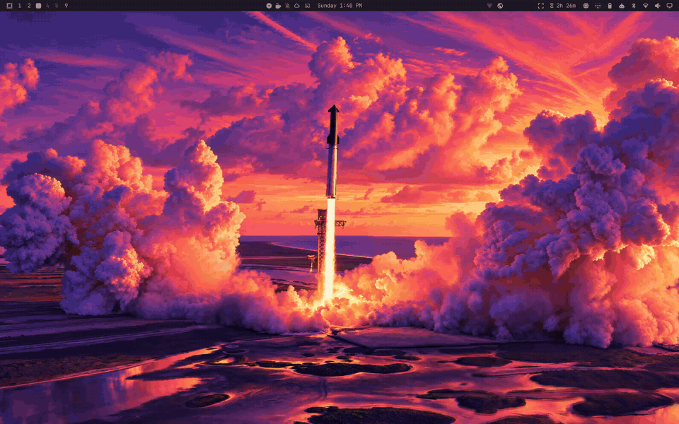
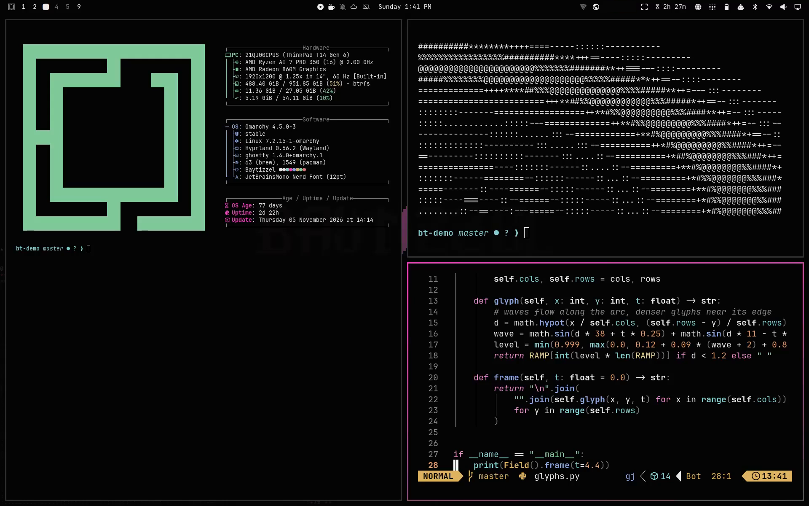

# OmaBay

An [Omarchy](https://omarchy.org) theme built from the [baytizzel.dev](https://baytizzel.dev) design system: near-black, monochrome, one hot-pink accent, and the site's ASCII glyph field and pixel banner as wallpapers.





## Install

```bash
omarchy theme install https://github.com/betizzel/OmaBay
```

It installs as `omabay` and shows up as Omabay in the theme picker.

## What's inside

**Palette.** The core colors are the site's CSS tokens: `#050505` background, `#0c0c0c` surfaces, `#ededed` text, `#8c8c8c` and `#5c5c5c` secondary text, `#ff45c8` accent. The ANSI colors are softened around the pink so diffs, errors, and syntax highlighting stay readable. Selecting text in the terminal turns it hot pink on black, like the site's `::selection`, and window borders use the banner's pink-to-gray gradient.

**Wallpapers.** All five are rendered from the site's own canvas code.

| File | |
|---|---|
| `1-baytizzel.png` | Glyph field and BAYTIZZEL banner, with an intro |
| `2-glyph-field.png` | The glyph field alone, with an intro |
| `3-baytizzel-live.mp4` | Live loop: the waves and sparkles move, and the banner cycles through the site's four effects |
| `4-omarchy.png` | Glyph field with the Omarchy logo, with an intro |
| `5-omarchy-live.mp4` | Live loop with the Omarchy logo |

The intros play when you switch to the theme (or log in) with a still wallpaper selected: the field ripples out of the corner and the banner decodes. The live loops are 54 seconds long and repeat seamlessly. Switch wallpapers with `Super + Ctrl + Space`, or cycle with `omarchy theme bg next`.

**Boot screen.** `unlock.png` puts the banner on the disk-unlock screen:

```bash
omarchy plymouth set by theme omabay
```

**Icons.** Yaru-magenta.

Tested on Omarchy 4.5.0.

## Credits

- Banner lettering in the figlet font Delta Corps Priest 1; the Omarchy wallpapers use Omarchy's own `logo.txt`.
- Glyph field and banner animations ported from baytizzel.dev.

## License

[MIT](LICENSE)
